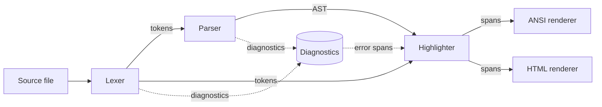

# Design

This document describes how the front end is organised and why it is built this way. The lexical rules are in [lexical.md](lexical.md) and the grammar is in [grammar.md](grammar.md).

## Pipeline



Each stage is a free function that takes the previous stage's output and appends any problems it finds to a shared `std::vector<Diagnostic>`:

```cpp
std::vector<Token> tokenize(const SourceFile& source, std::vector<Diagnostic>& diagnostics);
Program parse(const std::vector<Token>& tokens, std::vector<Diagnostic>& diagnostics);
std::vector<HighlightSpan> highlight(const std::vector<Token>& tokens, Program& program,
                                     const std::vector<Diagnostic>& diagnostics);
std::string renderAnsi(std::string_view source, const std::vector<HighlightSpan>& spans);
std::string renderHtml(std::string_view source, const std::vector<HighlightSpan>& spans,
                       std::string_view title);
```

The `Lexer` and `Parser` classes that do the work are private to their `.cpp` files. A stage depends only on the data types of the stage before it, so each one can be tested on its own, and phase 2 can add a semantic analyzer between the parser and the highlighter without changing either.

## Modules

| File | Responsibility |
|---|---|
| `source.hpp` | `SourceFile` (name and text) and `SourceLocation` (file, line, column, offset) |
| `diagnostic.hpp/.cpp` | `Diagnostic` and its `file:line:col: error: message` format |
| `token.hpp/.cpp` | `TokenKind`, `Token`, token categories and the token-stream format |
| `lexer.hpp/.cpp` | Hand-written DFA scanner and escape decoding |
| `ast.hpp/.cpp` | AST node hierarchy, `Visitor` and `RecursiveVisitor` |
| `parser.hpp/.cpp` | Recursive-descent parser with panic-mode recovery |
| `ast_printer.hpp/.cpp` | Indented tree dump used by `bminor ast` and the tests |
| `highlighter.hpp/.cpp` | Maps tokens and AST information to highlight categories |
| `render.hpp/.cpp` | ANSI and HTML output |
| `main.cpp` | Command-line interface |

Everything except `main.cpp` is built into the `bminor_core` static library, which both the `bminor` executable and the test binary link against.

## Data structures

### Tokens and locations

A `Token` holds its kind, its lexeme as a `std::string`, and a `SourceLocation`. The location keeps the byte offset as well as the line and column. The offset lets the renderers copy the original text between tokens unchanged, and lets the highlighter match AST nodes to tokens.

`SourceLocation::file` is a `std::string_view` into the `SourceFile` that was lexed. A file name is the same for every token, so viewing it avoids a copy per token. The cost is a lifetime rule: the `SourceFile` must outlive its tokens and AST. Compilers such as Clang handle this the same way, through a source manager.

### AST

The AST is a class hierarchy with three abstract bases, `Decl`, `Stmt` and `Expr`, all derived from `Node`:

```
Node { location, type }
├── Decl { name }
│   ├── VarDecl      declaredType, initializer
│   └── FuncDecl     returnType, params, body
├── Stmt
│   ├── BlockStmt    statements
│   ├── DeclStmt     declaration
│   ├── ExprStmt     expression
│   ├── IfStmt       condition, thenBranch, elseBranch
│   ├── ForStmt      init, condition, step, body
│   ├── WhileStmt    condition, body
│   ├── ReturnStmt   value
│   └── PrintStmt    arguments
└── Expr
    ├── IntegerLiteral, BooleanLiteral, CharLiteral, StringLiteral, Identifier   (leaves)
    ├── UnaryExpr    op, operand
    ├── PostfixExpr  op, operand
    ├── BinaryExpr   op, left, right
    ├── AssignExpr   target, value
    ├── CallExpr     callee, arguments
    ├── IndexExpr    array, index
    └── ArrayLiteral elements
```

- **Ownership.** Children are owned through `std::unique_ptr`, so the tree is freed automatically and cannot be shared by accident. Optional children, such as a missing `else` or a function prototype's body, are null pointers.
- **Locations.** Every node stores the location of its first token. Nodes that start with a child (`BinaryExpr`, `CallExpr`, `AssignExpr`, ...) take the location from that child in their constructor, which keeps the rule consistent without the parser having to pass it around.
- **Type annotations.** `Node::type` is the annotation field the semantic analyzer fills in phase 2. It is null after parsing.
- **Declared types.** Types written in the source (`array [5] integer`) are a small value type, `Type`, shared through `std::shared_ptr<const Type>`. Phase 2 can point annotations at the same immutable objects instead of copying them.
- **Operators.** Operators are stored as `TokenKind` rather than as strings, so later phases can switch on them.
- **Parentheses.** They only group, so there is no node for them. `(a + b) * c` is simply a `BinaryExpr` whose left child is the `+` node.

### Visitors

Passes over the tree use the classic Visitor pattern: each node's `accept` calls the matching `Visitor::visit` overload. Adding a new pass therefore needs no changes to the nodes, which matters because the project adds passes in every phase: printing, highlighting, name resolution, type checking and control-flow construction. `RecursiveVisitor` provides a default traversal of every child, so a pass overrides only the nodes it cares about. The highlighter's pass is about 20 lines.

Visitors take nodes by non-const reference because the phase-2 analyzer writes `Node::type` while walking the tree.

## Parser

The parser is recursive descent with one method per grammar rule. [grammar.md](grammar.md) shows that the grammar is LL(1) apart from one two-token lookahead. All binary operator levels share `leftAssociative`, which takes the next-higher level as a member-function pointer. That keeps one small function per precedence level without repeating the same loop five times.

Comments and `INVALID` tokens are removed before parsing. Comments carry no syntax. Invalid tokens were already reported by the lexer, and parsing around them avoids a second, misleading error for the same character.

## Error handling

Neither stage stops at the first error, and both always return a result. A program with errors still produces a token stream, a partial AST and highlighted output.

### Lexer

Bad input becomes an `INVALID` token plus a diagnostic, and scanning resumes right after it. The individual cases are listed in [lexical.md](lexical.md#lexical-errors).

### Parser: panic mode

When the parser meets a token that cannot continue the current rule, it reports `expected X, got Y` at that token and throws a `ParseError`. The exception unwinds to the nearest recovery point. Two loops catch it:

1. **The statement loop in `block()`.** `synchronize()` skips tokens until one of these synchronization points:
   - just after a `;`, which ends the broken statement;
   - before `}`, so the enclosing block can still close;
   - before `{`, `if`, `for`, `while`, `return` or `print`, which start a new statement;
   - before `IDENT ':'`, which starts a declaration.

   If no token was consumed at all, one is skipped, so the loop always makes progress.
2. **The declaration loop in `parseProgram()`.** `synchronizeDeclaration()` skips to the next `IDENT ':'` at brace depth zero. Counting braces means that when a function header is broken, its whole body is skipped, instead of its local declarations being mistaken for global ones.

Exceptions keep the parsing functions free of error-propagation code. Each function can assume that a call either succeeded or left the method entirely. A `ParseError` is only thrown for syntax errors, a few times per file at most, so the cost does not matter.

Three errors are reported without throwing, because the parser knows exactly how to continue:

- `invalid assignment target`, for example `1 = x`. The expression is complete, so the parser keeps it.
- A block that reaches end of file without `}`. The function is kept with the statements parsed so far.
- An integer literal that does not fit in 64 bits. The value becomes 0.

Every error produces exactly one diagnostic. For the example from the project brief:

```
1  x: integer = ;      error at 1:14: expected expression, got ';'   (skips to ';')
2  y: integer = 42;    parsed normally
5      if (y > 0 {     error at 5:15: expected ')' after condition, got '{'
6          return y;   the block from '{' is still parsed, as a statement
7      }
```

## Highlighting

Highlighting runs in two steps:

1. **Token classes.** Each token gets a default class from its kind: keyword, type name, operator, number, string, boolean, comment or error. Identifiers default to *variable*. Delimiters and whitespace get no class.
2. **AST information.** A `RecursiveVisitor` walks the AST and records the offsets of every function name: the name in each `FuncDecl` and the callee of each `CallExpr`. Tokens at those offsets become *function*. This is the part a token-only or regex highlighter cannot do. In `f(n) + n` all three identifiers are `IDENT` tokens, and only the tree shows that `f` is called.

Finally every token at a diagnostic's location becomes *error*, so lexical and syntax errors are underlined in red where they occur.

The output is a list of `HighlightSpan { offset, length, highlight }` in source order. The renderers know nothing about tokens or the AST. They copy the source text and wrap each span:

| Category | ANSI | HTML class | Color |
|---|---|---|---|
| Keyword | `1;34` | `kw` | bold blue |
| Type name | `36` | `type` | teal |
| Variable | none | `var` | default |
| Function | `33` | `fn` | yellow |
| Number, boolean | `38;5;208` | `num`, `bool` | orange |
| String, char | `32` | `str` | green |
| Operator | `37` | `op` | light gray |
| Comment | `3;90` | `comment` | dim gray, italic |
| Error | `4;31` | `error` | red underline |

All text outside spans is copied unchanged, including whitespace, so the output reproduces the source exactly. A test strips the escape codes and compares the result with the input. Multi-line tokens such as block comments are reset before each newline and reopened after it, which keeps colors correct in pagers like `less -R`. The HTML page is a single file with an embedded stylesheet and no JavaScript, and it escapes `& < > "`.

In phase 2 the second step can use the symbol table instead of call sites, for example to color a function name passed as a value.

## Command-line interface

```
bminor tokens <file>                     token stream, one token per line with its location
bminor ast <file>                        indented AST dump
bminor highlight [--html] [-o out] <file> highlighted source
```

Diagnostics go to standard error in `file:line:col: error: message` form, sorted by position, and output always goes to standard output or the `-o` file. The exit code is 0 when there were no diagnostics, 1 when the source had errors, and 2 for usage or I/O errors. This lets scripts tell apart "the program is wrong" and "the tool was called wrong".

## Testing

The test suite uses GoogleTest and runs through CTest:

- **Lexer:** every token category, longest match, keyword priority, locations (including UTF-8 columns), escapes, and every lexical error.
- **Parser:** expected AST dumps for declarations, statements, precedence, associativity, postfix chains and the dangling `else`. It also covers error recovery for each kind of syntax error and a stress test with random token soup.
- **Highlighter and renderers:** AST-based function detection, every category, error marking, exact ANSI reproduction and valid HTML.
- **Examples:** every program in `examples/` must produce no diagnostics, and every program in `examples/errors/` must produce some without crashing.
- **CLI:** each command runs on the example programs.

CI runs the suite with GCC, and with Clang under AddressSanitizer and UndefinedBehaviorSanitizer, which catches memory errors the assertions alone would miss. It also checks formatting with `clang-format` and builds the Docker image.
