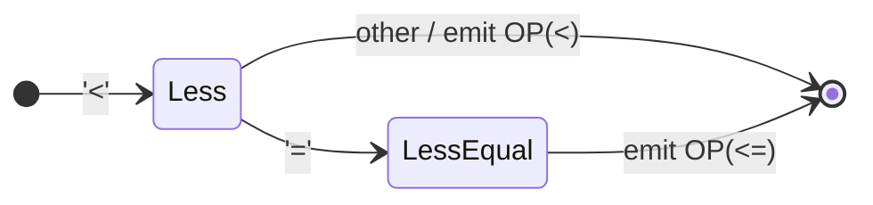

# Lexical Specification

This document defines the tokens of B-Minor, the rules the lexer uses to choose between them, and the errors it reports. The implementation is in [`src/lexer.cpp`](../src/lexer.cpp).

## Token categories

| Category | Token kinds | Examples |
|---|---|---|
| Keywords | `array auto boolean char else false for function if integer print return string true void while` | `if`, `return` |
| Identifiers | `IDENT` | `myVar`, `_count`, `x1` |
| Integer literals | `INT` | `0`, `42`, `007` |
| Boolean literals | `BOOL` | `true`, `false` |
| Character literals | `CHAR` | `'a'`, `'\n'`, `'\''` |
| String literals | `STRING` | `"hello\n"` |
| Operators | `OP`, `ASSIGN` | `+ - * / % ^ ++ -- ! < <= > >= == != && \|\| =` |
| Delimiters | `LPAREN RPAREN LBRACKET RBRACKET LBRACE RBRACE COMMA SEMI COLON` | `( ) [ ] { } , ; :` |
| Comments | `COMMENT` | `// text`, `/* text */` |
| Errors | `INVALID` | `@`, `"unterminated` |
| End of input | `EOF` | |

Whitespace separates tokens and is not emitted. Comments are emitted as tokens so the highlighter can color them. The parser skips them.

Every token stores its kind, its lexeme (the exact source text) and its source location: file name, line, column and byte offset. Lines and columns start at 1. A column counts characters, so a multi-byte UTF-8 character advances the column by one.

## Regular definitions

```
letter        = [A-Za-z_]
digit         = [0-9]
whitespace    = [ \t\n\r\f\v]+

identifier    = letter (letter | digit)*
keyword       = array | auto | boolean | char | else | false | for | function
              | if | integer | print | return | string | true | void | while
boolean       = true | false
integer       = digit+

escape        = \\ [^\n]
char          = ' ( [^'\\\n] | escape ) '
string        = " ( [^"\\\n] | escape )* "

line_comment  = // [^\n]*
block_comment = /\* ( [^*] | \*+ [^*/] )* \*+ /

operator      = \+\+ | -- | <= | >= | == | != | && | \|\| | [-+*/%^<>!=]
delimiter     = [()\[\]{},;:]
```

`boolean` is a subset of `keyword`. Its tokens are reported as `BOOL` instead of `KW` because they are literal values.

### Escape sequences

A backslash followed by any character except a newline is an escape. As in the B-Minor reference, `\n` is a newline and `\0` is the null character. A backslash before any other character stands for that character, so `\"`, `\'` and `\\` produce `"`, `'` and `\`. The lexer only checks that escapes are well formed. The parser decodes them when it builds literal nodes.

## Choosing between rules

More than one rule can match at a given position. The lexer resolves this with two rules.

**Longest match (maximal munch).** The lexer always takes the longest prefix that forms a token. `<=` is a single `OP(<=)`, never `OP(<)` followed by `ASSIGN`, and `x+++y` becomes `x`, `++`, `+`, `y`. Identifiers and integers consume every following letter or digit, so `returned` is one identifier, not `return` followed by `ed`.

**Keyword priority.** Every keyword also matches `identifier`. After the longest identifier-shaped lexeme has been read, it is looked up in the keyword table. If it is there the token is a keyword, otherwise an identifier. `return` is therefore `KW(return)`, while `returned` and `_return` are identifiers.

**Signs are operators.** The project brief calls integer literals "signed", but a leading `-` is always scanned as an operator. If `-1` were a single literal, longest match would turn `n-1` into `IDENT(n) INT(-1)`, which is wrong. Negative values come from unary minus in the grammar, which is how the B-Minor reference treats them.

## How the scanner works

The lexer is a hand-written deterministic finite automaton. `scanToken` is the start state: it reads one character and switches on it to pick a sub-automaton. Each helper (`identifierOrKeyword`, `integer`, `string`, `character`, `lineComment`, `blockComment`) is one of those sub-automata and loops until no further character can extend the token. Two-character operators need a single character of lookahead (`match('=')`), which is exactly the DFA transition from the accepting state of `<` to the accepting state of `<=`.



The same pattern covers `> >= = == ! != + ++ - --`. The `&` and `|` states have no accepting state of their own, so a lone `&` or `|` is an error.

The block comment automaton is the only one that needs two characters of lookahead (`*` followed by `/`) to leave its loop.

A hand-written scanner was chosen over a regex library or a generator such as flex. It gives exact control over locations and error recovery, needs no dependencies, and maps directly onto the automaton above.

## Lexical errors

The lexer never stops on bad input. It emits an `INVALID` token covering the bad text, records a diagnostic at the token's start and continues with the next character.

| Input | Diagnostic | Where scanning resumes |
|---|---|---|
| A character outside the alphabet, e.g. `@`, `$`, `#`, or a lone `&` or `\|` | `unexpected character '@'` | Next character. A multi-byte UTF-8 character is reported once. |
| `"abc` followed by a newline or end of file | `unterminated string literal` | At the newline |
| `'a` followed by a newline or end of file | `unterminated character literal` | At the newline |
| `''` or `'ab'` | `character literal must contain exactly one character` | After the closing quote |
| `/*` without a matching `*/` | `unterminated block comment` | End of file |

```
1  x: integer = 5@;    -> INVALID(@) reported at 1:15, then SEMI
2  y: integer = 10;    -> scanned normally
```

The parser drops `INVALID` tokens because the lexer has already reported them, so the declaration on line 1 above still parses as `x: integer = 5;`.
